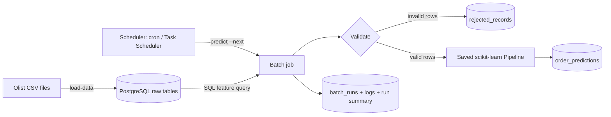

> [!WARNING]
> **🚧 Work in progress: not yet production-ready**
>
> This project is under active development by [@hexsyro](https://github.com/hexsyro).
> Interfaces, configuration keys and the database schema may change without notice,
> and some acceptance criteria are not yet met.
>
> **Feedback and issues are welcome:** please open a [GitHub issue](../../issues),
> or reach out on X: [@hexsyro](https://x.com/hexsyro).
>
> *Last updated: 22 November 2026*

# 📦 Late-Delivery Batch Predictor

**A scheduled, rerun-safe batch prediction system: PostgreSQL in, validated predictions out.**

The system reads e-commerce orders from PostgreSQL, validates them, predicts which orders are likely to be delivered **after their estimated delivery date**, and writes the predictions back with a timestamp and model version. Every run is logged, summarised, and safe to repeat.

> Part of a three-repository production-ML series: **batch prediction (this repo)** → `diamond-price-api` (deployed API) → `model-ops-lab` (monitoring, updates, rollback).

---


## 🎯 Project Questions

- Can late deliveries be flagged at purchase time, using only information available then?
- How much better is a trained pipeline than a "predict the base rate" baseline?
- Can a batch job be rerun any number of times without creating duplicate results?
- Do invalid inputs get rejected with a clear, queryable reason instead of crashing the job?

---

## 🏗️ Architecture



---

## 🔑 Key Design Decisions

| Decision                                                                       | Why                                                                                     |
| ------------------------------------------------------------------------------ | --------------------------------------------------------------------------------------- |
| Preprocessing + model saved as **one** scikit-learn `Pipeline`                 | Training and prediction use identical transformations; no retraining at prediction time |
| Predictions keyed by `(order_id, model_version)` with `ON CONFLICT DO NOTHING` | Rerunning a batch cannot create duplicates; new model versions coexist with old results |
| All writes for a run in **one transaction**                                    | A crash never leaves a half-written batch                                               |
| **Time-based** train/evaluation split                                          | Mirrors real use: train on the past, predict the future                                 |
| Only purchase-time features                                                    | Delivery timestamps, approval times and reviews would leak the answer                   |
| Rejected rows stored with a reason                                             | Bad data is visible and auditable, never silently dropped                               |
| Unseen categories handled by the pipeline                                      | New product categories do not break a batch                                             |

---

## 📁 Repository Structure

```
late-delivery-batch-predictor/
├── config/config.yaml           # non-secret settings (dates, paths)
├── sql/                         # table definitions and queries, numbered
├── src/batch_predictor/         # config, db, load_raw, features, validate, pipeline,
│                                #   train, evaluate, predict, summary, cli, logging_setup
├── scripts/                     # scheduler wrapper, bad-row injector, completion-check SQL
├── tests/unit/  tests/integration/
├── notebooks/                   # exploration only
├── models/  logs/  reports/     # generated artifacts (gitignored)
├── docs/                        # PROJECT_BRIEF, SCHEMA, OPERATIONS, LIMITATIONS, TROUBLESHOOTING
├── docker-compose.yml           # local PostgreSQL
├── pyproject.toml  requirements.txt  .env.example
└── README.md
```

---

## 🛠️ Setup

```bash
git clone https://github.com/hexsyro/late-delivery-batch-predictor && cd late-delivery-batch-predictor
python -m venv .venv && source .venv/bin/activate     # Windows: .venv\Scripts\activate
pip install -e ".[dev]"
cp .env.example .env
docker compose up -d                                   # local PostgreSQL
```

Download the Olist CSV files into `data/raw/` (see **Data**).

---

## 🚀 Usage

```bash
batch-predictor load-data                                   # load CSVs into PostgreSQL (idempotent)
batch-predictor train                                       # train, compare with baseline, save pipeline
batch-predictor predict --start 2018-07-01 --end 2018-07-08 # score one window
batch-predictor predict --next                              # score the next unprocessed window (scheduler)
batch-predictor summary --run-id 1                          # print the run summary
```

Scheduling: `scripts/run_scheduled_batch.sh` is invoked by cron (Linux/macOS) or Task Scheduler (Windows).

---

## 🗄️ Database Tables

| Table                                                                                                         | Purpose                                                                                              |
| ------------------------------------------------------------------------------------------------------------- | ---------------------------------------------------------------------------------------------------- |
| `orders`, `order_items`, `customers`, `sellers`, `products`, `order_payments`, `product_category_translation` | Raw input data                                                                                       |
| `order_predictions`                                                                                           | Output; primary key `(order_id, model_version)`; stores probability, label, `predicted_at`, `run_id` |
| `batch_runs`                                                                                                  | One row per run: window, model version, status, row counts, timings, error message                   |
| `rejected_records`                                                                                            | Rows that failed validation, with the reason                                                         |

Full column definitions: `docs/SCHEMA.md`.

---

## ✅ Testing

```bash
pytest -q                      # unit tests (no database needed)
pytest -q -m integration       # database-to-prediction tests (needs TEST_DATABASE_URL)
```

Covered: validation rules, feature helpers, unseen categories and missing values, and a rerun test asserting that a repeated batch adds no rows.

---

## 📈 Results

| Model                  | ROC-AUC | PR-AUC | Recall @ chosen threshold |
| ---------------------- | ------- | ------ | ------------------------- |
| Baseline (class prior) | —       | —      | —                         |
| Scikit-learn pipeline  | —       | —      | —                         |

Late-delivery rate (train / evaluation): — / —

---

## ⚠️ Limitations

See `docs/LIMITATIONS.md`. In short: historical data replayed as weekly batches (not live orders), a single marketplace and country, and a non-commercial dataset licence. Model scores are probabilities, not guarantees. Not covered: distributed processing, high-availability infrastructure, streaming, deep learning, automated retraining.

---

## 📄 Data

Olist Brazilian E-Commerce Public Dataset (Kaggle), ~100k orders across nine relational CSV files. Licensed CC BY-NC-SA 4.0 (non-commercial, share-alike).

---

## 🧰 Skills Demonstrated

| Area                 | Skills                                                                                                      |
| -------------------- | ----------------------------------------------------------------------------------------------------------- |
| SQL & databases      | PostgreSQL schema design, primary/unique keys, joins, aggregations, CTEs, transactions, idempotent writes   |
| ML pipelines         | `Pipeline` + `ColumnTransformer`, missing values, unseen categories, save/reload, no-retrain inference      |
| Software engineering | Modular `src/` layout, CLI entry points, config + environment variables, dependency management, Git history |
| Reliability          | Input validation, structured logging, run summaries, safe reruns, scheduled execution                       |
| Testing              | pytest unit and integration tests                                                                           |
| Documentation        | Operating guide, schema reference, limitations, troubleshooting                                             |

---

## 🔭 Possible Extensions

- Calibrate probabilities and choose the alert threshold from a cost trade-off
- Compare live predictions with actual outcomes as deliveries complete
- Containerise the job and run it from a Docker-based scheduler
